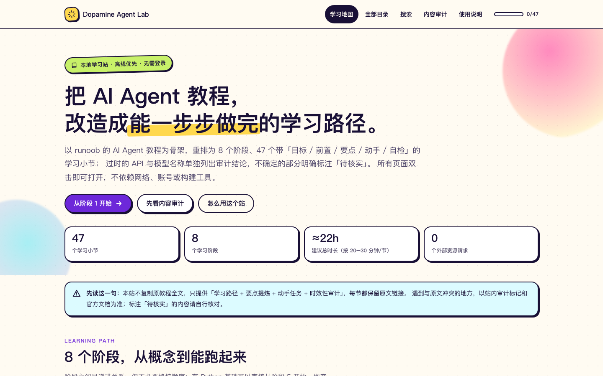
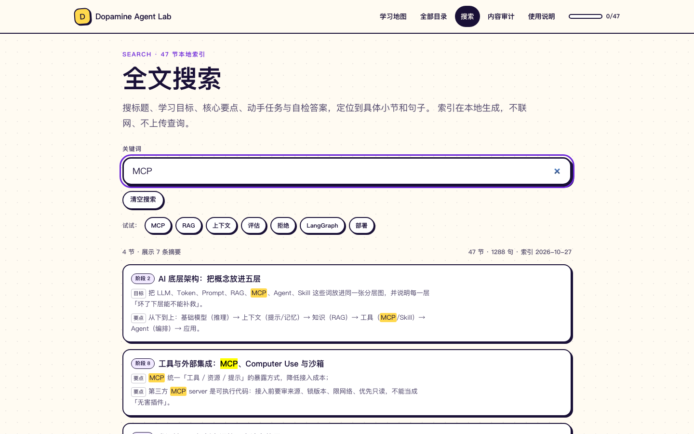
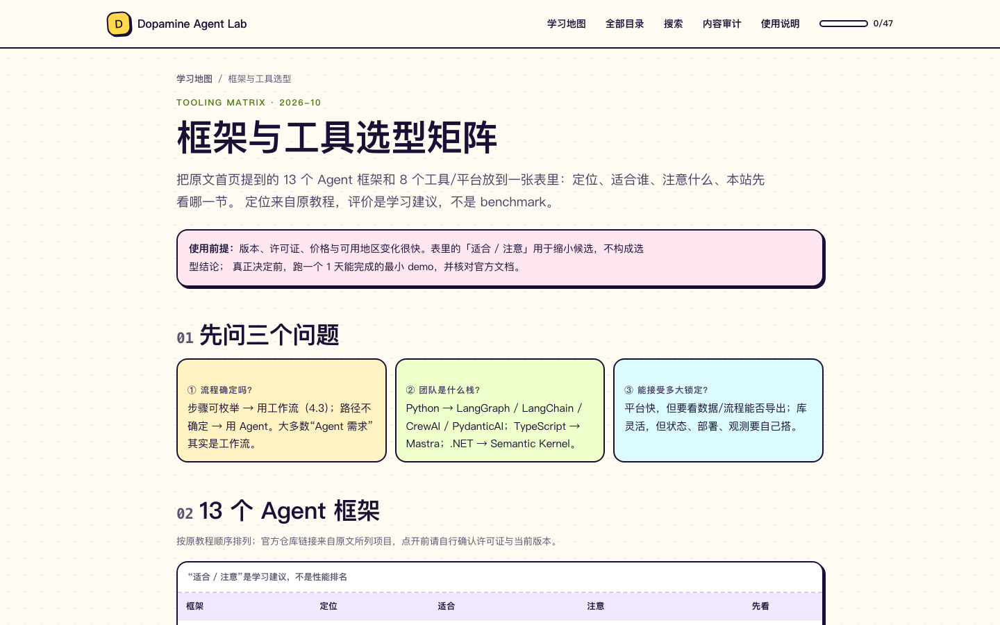
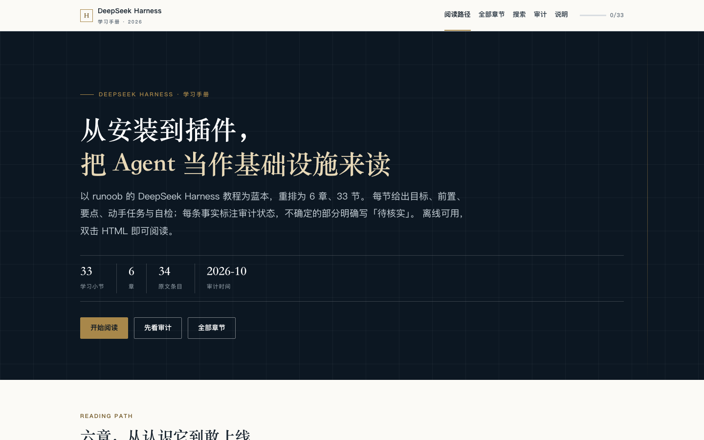

# Dopamine Agent Lab

以 runoob 教程为蓝本重构的**本地学习站**，包含两门课：

- **AI Agent 学习站**：47 节 / 8 阶段，多巴胺风格，附审计、全文搜索与框架矩阵。
- **DeepSeek Harness 手册**：33 节 / 6 章，正式文档风格，从安装、插件到沙箱与复盘。

> 个人学习项目：代码 MIT，原创文字 CC BY-NC-SA 4.0。不复制原文全文；每节保留原文链接，版权归原站点所有。



---

## 预览

| 全文搜索 | 框架与工具矩阵 |
|---|---|
|  |  |



## 两门课

| 课程 | 入口 | 风格 | 规模 |
|---|---|---|---|
| AI Agent 学习站 | [`index.html`](index.html) | 多巴胺 / 贴纸感 | 47 节 · 8 阶段 |
| DeepSeek Harness 手册 | [`deepseek-harness/index.html`](deepseek-harness/index.html) | 正式文档 / 纸白墨蓝 | 33 节 · 6 章 |

两门课共用同一套 MIT + CC BY-NC-SA 4.0 许可；各自有独立的 `assets/`、搜索索引与构建脚本。

## 打开方式

1. 保持目录完整（HTML 与 `assets/` 同级）。
2. 双击 `index.html`，浏览器以 `file://` 打开即可。
3. 无需安装、无需服务器、无需联网。学习进度保存在本机 `localStorage`。

## 文件结构

```
ai-agent-learning/
├── index.html          学习地图：8 阶段总览、总进度、优先更新 Top 3
├── stage-1.html        阶段 1 · 认知地图（4 节）
├── stage-2.html        阶段 2 · 模型与提示（5 节）
├── stage-3.html        阶段 3 · 推理、知识与上下文（4 节）
├── stage-4.html        阶段 4 · 架构与工具选型（3 节）
├── stage-5.html        阶段 5 · 亲手构建（7 节）
├── stage-6.html        阶段 6 · 框架与平台（7 节）
├── stage-7.html        阶段 7 · 前沿产品与工程范式（9 节）
├── stage-8.html        阶段 8 · 多智能体、生产化与扩展（8 节）
├── contents.html       全部目录：保留原文 leftcolumn 的 3 组 48 项顺序
├── frameworks.html     13 个 Agent 框架 + 8 个工具/平台的选型矩阵
├── search.html         全文搜索：按关键词定位到小节与句子
├── audit.html          审计台账（47 行）+ 更新对照表 + 方法说明
├── about.html          假设声明、设计令牌、维护指引、待核实清单
├── deepseek-harness/   第二门课：DeepSeek Harness 手册（33 节，正式文档风格）
│   ├── index.html / stage-1..6.html / contents / search / audit / about
│   ├── assets/         独立设计令牌、进度与搜索
│   └── tools/build.py  课程数据 + 页面/索引生成
├── LICENSE             MIT（代码）
├── LICENSE-CONTENT.md  原创文字许可与署名说明（CC BY-NC-SA 4.0）
├── LICENSE-CC-BY-NC-SA-4.0.txt  CC BY-NC-SA 4.0 完整法律文本
├── examples/
│   ├── stage5/         第 5 阶段完整 Python 实验、固定依赖、测试与实际输出
│   ├── stage5-examples.zip     第 5 阶段下载包
│   ├── stage6/         第 6 阶段七个入口、固定依赖、平台工作流与测试
│   └── stage6-examples.zip     第 6 阶段下载包（不含密钥和运行缓存）
├── tools/
│   ├── capture_stage5_outputs.py  执行离线示例并记录预期输出
│   ├── build_stage5_examples.py   把源码/输出嵌入 HTML 并生成下载包
│   ├── capture_stage6_outputs.py  在独立环境与 Docker 中执行七个入口
│   ├── build_stage6_examples.py   同步第 6 阶段源码、输出与下载包
│   ├── link_chapters.py        重建 47 节前后篇并同步 STAGE_TOTAL
│   └── build_search_index.py   从 8 个阶段页重建搜索索引
├── assets/
│   ├── style.css       全部设计令牌与组件样式
│   ├── app.js          进度、目录高亮、目录筛选、全文搜索、轻提示
│   ├── lesson-map.js   首页继续学习使用的章节标题、链接与时长
│   ├── search-index.json       搜索索引（纯 JSON，可检查）
│   └── search-index.js         同一份索引的脚本包装（file:// 可用）
└── README.md
```

## 全部目录（对照原文左侧栏）

`contents.html` 保留原文 `#leftcolumn` 的 **3 个分组、48 个链接**（教程首页 + 47 章），
并标出每章在本站属于哪个阶段。原文分组的章节数：

- 基础概念（原文首段无标题）：15 项（含教程首页）
- 智能体工具：19 项
- Python 实现智能体：14 项

本站覆盖 **47/47 章，0 缺失**；差异只在顺序与呈现方式：原文按「概念 → 工具 → Python」，
本站学习路径按 8 阶段递进，目录页保留原序。支持按章节名/工具名搜索与完成进度显示。

## 新增的导学能力

- **继续学习**：首页优先回到上次未完成的小节；完成后推荐后续未完成小节，全部完成时进入课程回顾。兼容已有完成记录。
- **进度保存反馈**：保存失败时保留本页临时状态，显示持续提示与重试按钮；清空失败时保留原记录。清空成功同时重置上次阅读位置。
- **移动端目录**：手机和平板使用阅读区顶部可展开的本阶段目录，显示当前小节，选择后自动收起并定位正文；桌面默认展开。无 JavaScript 时仍可手动展开目录。
- **章级前后篇**：47 节按 8 阶段顺序串成一条线，阶段边界自动跨页；第一节回到学习地图，最后一节进入审计台账。
- **框架选型矩阵**：`frameworks.html` 对比原文提到的 13 个框架与 8 个工具/平台，含定位、适合、注意与对应小节。
- **全文搜索**：`search.html` 搜索 47 节的目标、要点、任务与自检答案（约 900+ 句），结果显示命中句子并链接到小节。
  展示全部命中小节，每节最多两条摘要；支持多关键词安全高亮，清空搜索同时移除 URL 中的关键词。
  索引由 `tools/build_search_index.py` 生成；`file://` 下不能 fetch JSON，所以同时输出 `search-index.js` 供页面加载。
  修改任何小节文字后，运行（同时更新首页的 `lesson-map.js`）：

  ```bash
  python3 tools/build_search_index.py
  ```

## 内容结构

第 5 阶段的 7 节现已附带可运行实验。入口、共享模块、3 篇 RAG 教学资料和运行说明位于 `examples/stage5/`。
默认离线只用 Python 标准库；真实 API 模式使用锁定的 OpenAI SDK，须自行配置密钥。
离线运行与模拟 HTTP 的 SDK 契约测试已在 Python 3.11.15 通过，**真实 API 端到端调用尚未验证**。
详细环境、命令、输出与故障处理见 `examples/stage5/README.md`，验证边界见 `VALIDATION.md`。

修改实验代码后，从学习站根目录运行：

```bash
python3.11 -m unittest discover -s examples/stage5/tests -v
python3.11 tools/capture_stage5_outputs.py
python3.11 tools/build_stage5_examples.py
python3.11 tools/build_search_index.py
```

安装 `examples/stage5/requirements-lock.txt` 后可运行 SDK 契约测试；未安装时这部分会明确跳过。
请检查新的 `expected/` 输出再生成页面，避免把意外行为当作预期。HTML 中标记为 `STAGE5-EXAMPLE` 的区块由脚本维护。

第 6 阶段的 7 节也已补齐实验：LangChain、LangGraph、CrewAI、Deep Agents 真正执行框架，模型响应使用固定脚本；Dify 验证 API 客户端；n8n 在断网临时容器内执行工作流；GraphRAG 验证官方 CLI 的初始化与 dry-run。15 项行为/契约测试通过。平台在线调用及真实索引质量尚未验收，具体见 `examples/stage6/VALIDATION.md`。

安装和运行详见 `examples/stage6/README.md`。第 6 阶段分三个虚拟环境，不要与第 5 阶段混装。修改后先执行各环境的测试，再从站点根目录更新输出与页面：

```bash
python3.11 tools/capture_stage6_outputs.py \
  --framework-python examples/stage6/.venv-frameworks/bin/python \
  --crew-python examples/stage6/.venv-crew/bin/python \
  --graph-python examples/stage6/.venv-graph/bin/python
python3.11 tools/build_stage6_examples.py
python3.11 tools/build_search_index.py
python3.11 tools/verify_stage6_examples.py
```

采集需要 Docker 已启动且 n8n 镜像已下载；全部成功才写入 expected/。检查输出后再生成页面。`STAGE6-EXAMPLE` 区块由脚本维护，ZIP 排除 `.env`、虚拟环境和运行缓存。

| 阶段 | 主题 | 节数 | 时长 |
|---|---|---|---|
| 1 | 认知地图 | 4 | ≈1.5h |
| 2 | 模型与提示 | 5 | ≈2h |
| 3 | 推理、知识与上下文 | 4 | ≈2h |
| 4 | 架构与工具选型 | 3 | ≈1.5h |
| 5 | 亲手构建 | 7 | ≈4.5h |
| 6 | 框架与平台 | 7 | ≈4h |
| 7 | 前沿产品与工程范式 | 9 | ≈3h |
| 8 | 多智能体、生产化与扩展 | 8 | ≈4h |

总计 47 节、约 22 小时（按每节 20–30 分钟核心学习 + 动手计）。

## 内容时效审计（摘要）

审计覆盖全部 47 节：**21 仍然成立 / 8 表述过时 / 5 建议补充（已全部在站内补齐）/ 13 存疑待核实**。

优先处理：

1. **P0 · 5.1 环境配置** — `initialize_agent`、`text-davinci-003`、`gpt-3.5-turbo`、`langchain.llms` 旧导入；且推荐已 EOL 的 Python 3.9。
2. **P0 · 8.1 多智能体** — AutoGen 0.2 API（`autogen.AssistantAgent` / `llm_config` / `GroupChat`），当前稳定线为 `autogen-agentchat` 0.7.x。
3. **P1 · 6.1 / 4.3 / 3.3** — LangChain 1.x 应以 `create_agent` 为入口；text splitter 已拆到 `langchain-text-splitters`。

「建议补充」的 5 条已在对应小节补齐：

- 3.1 推理与规划 → 推理模型时代的 CoT 取舍
- 3.4 上下文工程 → 子 Agent 隔离、动态工具注册、压缩后校验
- 8.2 工具集成 → 三类接入方式控制清单、MCP 信任边界
- 8.4 评估安全 → 5 条可执行攻击用例与指标
- 8.5 生产部署 → 队列/checkpoint、trace、配置回滚、SLO

完整 47 行台账、严重度/优先级/依据、以及 12 条「原文 → 更新后 → 理由」对照，见 `audit.html`。

## 设计令牌

集中在 `assets/style.css` 的 `:root`：

| 令牌 | 值 | 说明 |
|---|---|---|
| `--ink` | `#191036` | 正文 / 边框（对比度 17.4:1） |
| `--paper` | `#FFFBF2` | 页面底色 |
| `--muted` | `#5B5470` | 次要文字（7.3:1） |
| `--violet` | `#6D28D9` | 主强调（白字 7.1:1） |
| `--pink` | `#FF2E93` | 强调块（墨字 5.2:1） |
| `--yellow` / `--lime` / `--cyan` / `--orange` | 见 CSS | 标签、任务、自检、警示 |

- 字体：系统中文字体栈，零外部字体。
- 动效：150–220ms，只动 `transform` / `opacity`，支持 `prefers-reduced-motion`。
- 阴影：实色偏移（`3px 3px 0`），不依赖模糊。

## 新增一节

1. 复制 `stage-N.html` 中一个 `<article class="lesson">` 整块。
2. 同步修改三处标识：`id="sN-M"`、`lesson-badge` 的编号、`data-done-id="sN-M"`。
3. 补齐五个字段与原文链接。
4. 在侧边目录 `.toc` 增加锚点；如果是原文已有章节，在 `contents.html` 对应分组加一行。
5. 运行 `python3 tools/link_chapters.py`：重建前后篇，并自动同步 `STAGE_TOTAL`。
6. 运行 `python3 tools/build_search_index.py`：把新增/修改的要点纳入全文搜索。
7. 刷新后点一次「标记完成」，确认进度条与圆环变化。

## 待核实清单

以下内容无法在审计时确证，使用前请查官方来源：

- 模型命名与版本：GPT-6 Astra、DeepSeek V4、Claude 4.6、GPT-5.5 / Claude 5 等。
- 框架版本：LangChain / AutoGen / CrewAI / GraphRAG 的当前 API 与版本区间。
- Python 生命周期：3.9（已于 2025-10 EOL）、3.10 的 EOL 时间。
- 产品信息：DuMate、WorkBuddy、MonkeyCode、OpenClaw 的可用地区、额度、系统要求、安装命令。
- 统计数字：Harness Engineering 章节引用的代码行数、团队规模等。

## 许可证

本仓库采用**双许可**：

| 范围 | 许可证 |
|---|---|
| 代码：HTML / CSS / JavaScript、`tools/` 脚本、`examples/` 示例代码 | **MIT**（[`LICENSE`](LICENSE)） |
| 原创文字：学习路径、要点、动手任务、自检题、内容审计、框架选型说明、页面文案 | **CC BY-NC-SA 4.0**（[`LICENSE-CONTENT.md`](LICENSE-CONTENT.md)） |
| runoob 原文与第三方内容 | 不在本仓库授权范围，归各自权利人 |

- CC 完整法律文本：[`LICENSE-CC-BY-NC-SA-4.0.txt`](LICENSE-CC-BY-NC-SA-4.0.txt)
- 建议署名：`"Dopamine Agent Lab" by LuOzawa, based on the runoob AI Agent Tutorial.` 并保留每节原文链接。
- CC BY-NC-SA 的 **NC** 限制商业使用；如果希望允许商用，可把原创文字改为 CC BY-SA 4.0，代码仍为 MIT。

## 来源

- 蓝本：<https://www.runoob.com/ai-agent/ai-agent-tutorial.html>（版权归原站点/原作者）。
- 本站不复制原文全文，只提供学习路径、要点提炼、任务与审计；原文与商标不在本站授权范围。

---

审计时间：2026-10。产品、模型与 API 变化很快，遇到冲突以官方文档为准。
